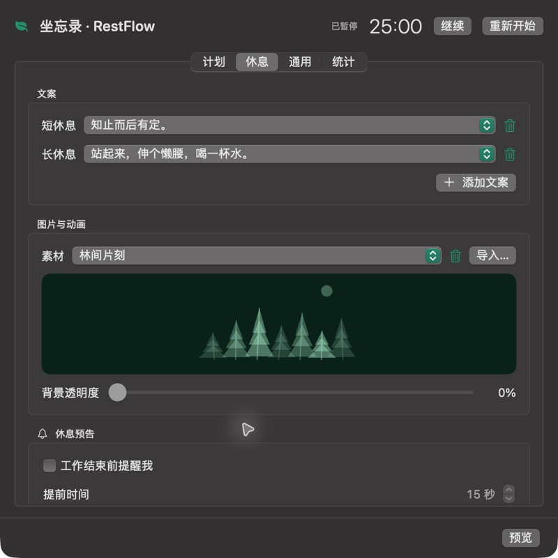
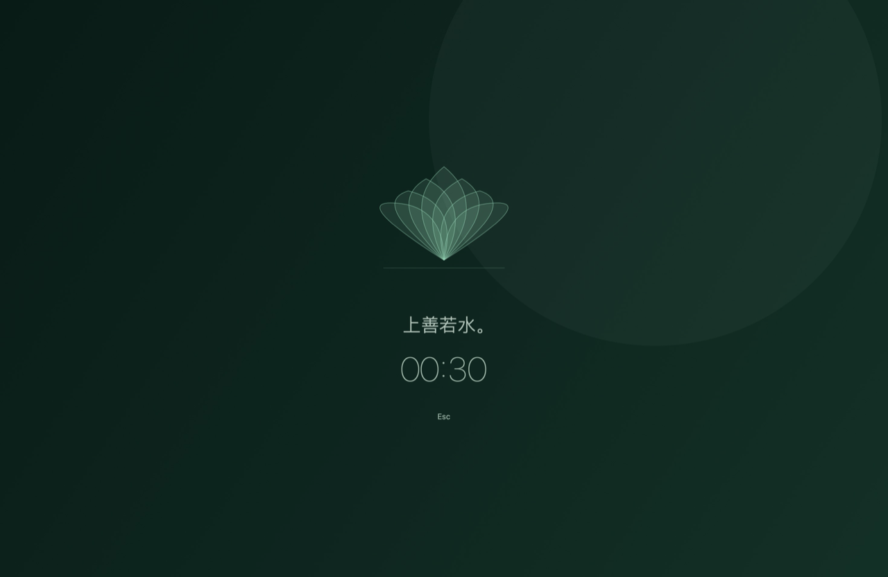

# 坐忘录 · RestFlow

一款轻量的 macOS 菜单栏休息工具。免费，无账户、广告和追踪。

**久坐忘了时间，录下来提醒你。** 中文名「坐忘录」借意于《庄子》的“坐忘”，“录”也与界面的绿色相呼应。系统首选中文时显示「坐忘录」，英文时显示 RestFlow，两个名字都可用于搜索应用。

| 设置 | 休息界面 |
| --- | --- |
|  |  |

## 特色

- **专注与休息循环**：默认专注 25 分钟、短休息 30 秒，每 2 段专注后长休息 5 分钟；支持暂停、重新开始和现在休息。
- **多屏同步**：全屏休息、柔和配色、背景与动画透明度可调，按 Esc 或点击 Esc 提前结束。
- **自由选择内容**：12 条文案、12 款动态矢量场景，支持随机、添加／删除文案、导入图片／GIF／Lottie、删除及恢复内置内容；重复文案自动识别。
- **专注白噪音**：12 种具体声景可多选混合，独立音量；随机每段专注更换组合，可选择混合数量。菜单和自定义快捷键一键启停。
- **按自己的习惯使用**：文案、动画和声音均可选“无”；12 种 macOS 系统提示音、可隐藏及导入、中英文切换、自定义快捷键、开机启动及版本检查。
- **少打扰**：闲置自动暂停、离开后重新专注，每段专注可延后休息 3 分钟；离开检测可关闭。
- **工作时段与统计**：默认工作日 09:00–12:00、13:30–18:30 运行，星期和时间可调；按天查看近一周／一个月的计时、休息、离开与提前结束情况，数据仅存本地。

## 安装

需要 **Apple Silicon、macOS 13+**。[下载最新版本](https://github.com/wsgggws/RestFlow/releases/latest)，或使用 Homebrew：

```sh
brew tap wsgggws/restflow https://github.com/wsgggws/RestFlow.git
brew install --cask restflow
```

若提示 `untrusted tap`，执行 `brew trust --cask wsgggws/restflow/restflow` 后重试。

更新：`brew update && brew upgrade --cask wsgggws/restflow/restflow`。

当前版本使用临时签名，**尚未 Apple 公证**。首次打开若被拦截，请确认来自本仓库，再按“系统设置 → 隐私与安全性”中的提示允许打开。

## 使用

点击菜单栏叶子图标查看当前阶段与剩余时间，暂停、重新开始、现在休息或打开设置。“菜单栏显示时间”和“开机启动”可直接在菜单的“设置…”下方勾选；休息时显示 ☕︎，暂停时显示 ⏸。

“启用白噪音”可在菜单直接勾选，快捷键在“通用”中设置。悬停菜单的“更换白噪音”即可随机或连续勾选多个声音；再点一次取消，点“随机”会按设置中的混合数量重新抽取。音量和随机数量在“计划 → 专注”中调整；随机与手选互斥，默认关闭，不支持导入。暂停、离开、休息、睡眠及非运行时段自动静音。

“现在休息”按当前循环安排短／长休息。在设置中调整计划、上午／下午运行时段和休息内容。“预览”随时可用，不计入统计，按 Esc 或点击 Esc 后恢复原计时。计划修改从下一阶段生效，重新开始可立即应用。

设置最后的“统计”页提供每日图表和汇总，只计入应用在运行时段内实际计时；暂停、午休、睡眠、预览及应用关闭不计；计时不等同于实际专注程度。

离开检测默认开启：闲置 1 分钟暂停，未满 5 分钟回来继续，满 5 分钟回来开始新一段专注，保留长休息周期。阅读或看视频时可在“计划”关闭。随机在多个候选间避免连续重复。

某类休息的文案与动画都选“无”时，仅运行计时和声音；声音也关闭则完全安静运行，仍可从菜单查看状态。

设置自动保存在 `~/.config/restflow/config.json`，也支持直接编辑和相对素材路径。详见[配置说明](docs/CONFIGURATION.md)。

[源码构建](docs/BUILDING.md) · [MIT 许可](LICENSE) · [第三方许可](THIRD_PARTY_NOTICES.md)
